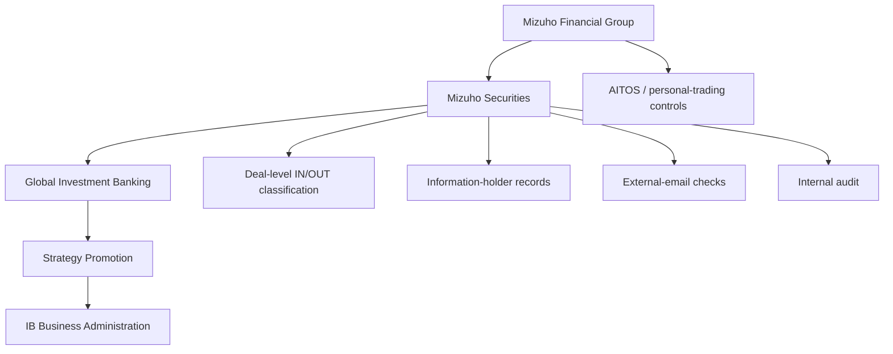
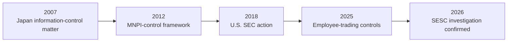
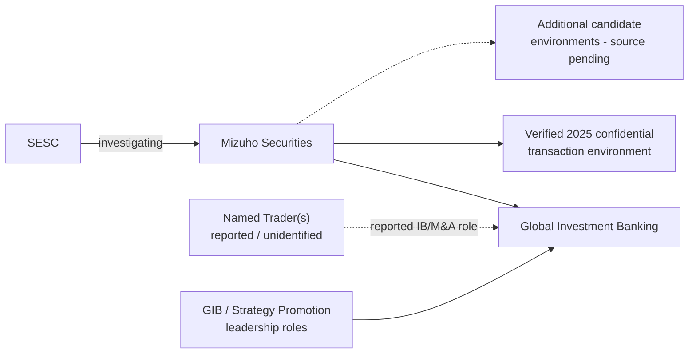
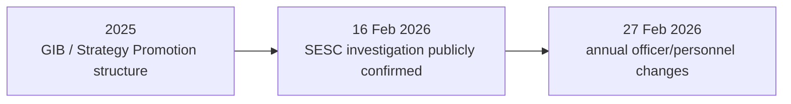

# PROJECT BLACKBIRD

# THE MIZUHO CONSPIRACY FILE — PUBLIC EDITION

**A Privacy-Minimised Open-Source Intelligence Case Study of Information-Control Risk, Transaction Governance, and the 2026 SESC Investigation**

| Field | Value |
|---|---|
| Case Reference | JP-01 |
| Prepared by | Ninomae Tsukumo |
| Purpose | Personal research and educational study |
| Classification | Open Source / Unclassified |
| Research Cut-Off | 5 September 2026 |
| Edition | Public / Privacy-Minimised |
| Language | English — simple-language edition |

**DOI:** 10.5281/zenodo.22987567  
**Permanent Archive:** https://doi.org/10.5281/zenodo.22987567

## IMPORTANT NOTICE

This report is an independent open-source intelligence case study prepared for personal interest, educational purposes, and the development of OSINT and analytical skills. It was not prepared on behalf of a regulator, law-enforcement authority, financial institution, employer, client, media organisation, political organisation, or other third party.

The report uses information lawfully available through public sources. It does not determine criminal, civil, regulatory, or disciplinary liability.

The word **“Conspiracy”** in the title is the name of an investigative case-study framework. It does not mean this report has established a conspiracy, insider-trading scheme, criminal agreement, information leak, concealment, regulatory violation, or misconduct.

### Privacy-minimisation rule

This public edition intentionally removes or abstracts individual names where identity is not necessary to understand the verified institutional finding. Organisational roles, departments, companies, dates, controls, and source IDs are used instead wherever possible. A documented connection, shared employer, transaction relationship, network proximity, or appearance in a diagram does not imply misconduct.

**Defined case term — Named Trader(s):** Project Blackbird’s neutral label for the unidentified person or persons whose alleged trading conduct is discussed in public reporting. The term does not mean that identity or headcount is publicly known.

# BOTTOM LINE UP FRONT

On 16 February 2026, Mizuho Securities confirmed that the Securities and Exchange Surveillance Commission (SESC) was investigating the company. Mizuho said the investigation was continuing and that it would cooperate. The company’s statement did not identify a person, security, account, transaction, profit amount, or alleged method. **[SRC-0001]**

Separate media reporting said the matter concerned an unidentified Mizuho Securities employee in investment banking, work-derived non-public information, and suspected trading involving multiple stocks. These details remain **Reported Information** because the official Mizuho statement does not confirm them. **[SRC-0002; SRC-0003]**

Project Blackbird therefore does not treat identity as the centre of the public analysis. The report focuses on the institutional environment: historical information-control problems, modern MNPI and personal-trading controls, investment-banking structure, selected 2025 confidential transaction environments, organisational chronology, competing explanations, negative findings, and the limits of public OSINT.

The strongest verified institutional finding is that Mizuho securities businesses have a documented history of information-control problems while also maintaining increasingly detailed formal controls. Japanese regulators established a Mizuho Securities information-control matter in 2007. The U.S. SEC separately found failures involving confidential issuer information at Mizuho Securities USA in 2018. **[SRC-0017; SRC-0018; SRC-0019]**

By 2012 Mizuho had publicly described a framework for material non-public information, and a 2025 SEC-filed procedure described employee-trading restrictions, restrictions on tipping and recommendations, treatment of some third-party-name trading, and the AITOS control system. **[SRC-0012; SRC-0020]**

**Central intelligence question:** If the reported 2026 conduct is eventually established, how could it have occurred inside an organisation that publicly documented extensive MNPI and employee-trading controls? Public OSINT does not currently answer that question.

# 1. INTRODUCTION

## 1.1 Purpose

JP-01 asks what public information can establish about the reported 2026 SESC investigation of Mizuho Securities. The purpose is not to prove a predetermined theory.

## 1.2 Principal Intelligence Requirement

> What can publicly available information establish regarding the reported 2026 SESC investigation into Mizuho Securities?

## 1.3 Scope

Historical review: 2007 to September 2026. Detailed focus: 2024 to 2026. Main jurisdiction: Japan. International Mizuho material is included only where useful as historical comparison or control context.

## 1.4 Out of Scope

- Private communications or restricted systems.
- Private brokerage-account data or non-public beneficial-ownership information.
- Family members or unrelated private associates.
- Identity speculation about the Named Trader(s).
- Treating ordinary professional relationships as evidence of misconduct.
- Determining criminal or regulatory liability.
- Publishing individual names where a role-level description is sufficient for the public analytical point.

# 2. METHODOLOGY

## 2.1 Collection Approach

Collection prioritised regulators, official corporate releases, exchange disclosures, regulatory filings, and primary corporate documents. Secondary media were used for facts not disclosed by official sources. Search engines, forums, professional profiles, and archived pages were used mainly for discovery and corroboration.

## 2.2 Evidence Model

| Classification | Meaning |
|---|---|
| Verified Fact | Directly supported by strong primary documentation. |
| Reported Information | Reported by a source but not independently established by a primary record. |
| Analytical Judgment | Interpretation based on established facts. |
| Hypothesis | Possible explanation that remains unproven. |
| Alternative Explanation | Plausible competing interpretation. |
| Negative Finding | A defined public-source search did not establish the proposed relationship. |
| Unknown | Available evidence is insufficient to determine the answer. |

**Core rule:** Source ≠ claim ≠ fact ≠ conclusion.

## 2.3 Corroboration and Competing Explanations

Independent corroboration was separated from repetition. Several articles repeating one original report were not treated as several independent confirmations.

Timing was never treated as proof of causation. Where an observation could support several explanations, ordinary alternatives — including annual personnel rotation, planned succession, normal advisory economics, market rumours, or routine governance practice — were kept visible.

## 2.4 AI-Assisted OSINT

AI was used to accelerate query generation, source discovery, Japanese-English comparison, document comparison, entity extraction, chronology, candidate prioritisation, hypothesis testing, negative-finding tracking, and preparation of network data. AI output was not treated as evidence. Significant factual statements had to be traceable to an underlying source.

## 2.5 Privacy and Proportionality

The public edition applies data minimisation. Unrelated private information, private family details, personal addresses, weak social proximity, unnecessary names, and person-level network detail are excluded unless essential to a verified public conclusion.

# 3. FINDINGS

## 3.1 Confirmed 2026 Investigation

Mizuho Securities confirmed that the SESC was conducting an investigation into the company as of 16 February 2026. Mizuho said the investigation remained ongoing and that it would cooperate fully. **[SRC-0001]**

The official statement does not establish the alleged trading method, securities, account, profit, or identity of the Named Trader(s).

## 3.2 Additional Public Reporting

Asahi reported that an employee under investigation belonged to Mizuho Securities’ investment-banking division, obtained non-public corporate information through M&A-related work, and was suspected in trading involving multiple stocks. Asahi also reported compulsory investigative activity in January 2026. **[SRC-0002]**

The Japan Times repeated the investment-banking detail while attributing it to earlier reporting; this is not treated as independent corroboration. **[SRC-0003]**

These points remain **Reported Information**.

## 3.3 Historical Information-Control Matters

SESC and FSA records establish a 2007 Mizuho Securities matter involving receipt and use of non-public customer information. The FSA issued a business-improvement order. **[SRC-0017; SRC-0018; SRC-0004]**

The U.S. SEC separately found that Mizuho Securities USA mishandled confidential issuer share-buyback information during 2012-2014 conduct; enforcement followed in 2018. **[SRC-0019]**

These are separate historical matters. They do not establish a continuous scheme or a connection between the people involved historically and the 2026 investigation.

## 3.4 Formal MNPI and Employee-Trading Controls

On 7 August 2012, Mizuho Securities published a framework intended to prevent unfair use of material non-public information. It described deal-level classification, controls over information holders, monitoring, external-email checks, internal audit, and need-to-know concepts. **[SRC-0012]**

A 2025 SEC-filed Mizuho procedure prohibited personal trading while knowing insider information, prohibited certain transmission and trading recommendations, treated some third-party-name transactions as personal trading, and described AITOS. **[SRC-0020]**

## 3.5 Verified 2025 Confidential Transaction Environment

A registered JPX disclosure confirms that Mizuho Securities acted as financial adviser to Digital Holdings in the 2025 Hakuhodo DY Holdings tender offer. Mizuho’s involvement was confirmed before the public announcement and the disclosure discusses information-barrier and conflict-management arrangements. **[SRC-0008]**

This establishes one verified Mizuho-linked confidential transaction environment. It does **not** establish that Digital Holdings was a security involved in the 2026 investigation.

Other candidate transactions remain analytical leads where the supporting primary documents were not fully registered in the evidence package. They are not promoted to verified findings in this public edition.

## 3.6 Organisational Chronology

Mizuho publicly confirmed the SESC investigation on 16 February 2026. On 27 February 2026, Mizuho issued an officer/personnel release containing changes relevant to the Global Investment Banking / Strategy Promotion structure. **[SRC-0001; SRC-0014; SRC-0015]**

The sequence is verified. A causal relationship is not established.

## 3.7 Negative Findings

Public-source research did **not** establish:

- the specific securities involved in the 2026 matter;
- the identity or number of the Named Trader(s);
- accounts, counterparties, or beneficiaries;
- the exact information-transfer path;
- direct involvement of any named organisational or governance figure in the suspected trading;
- involvement of any candidate transaction other than the existence of a relevant confidential environment;
- causation between the 16 February public confirmation and 27 February personnel changes; or
- a 2026 SESC/FSA/prosecutorial enforcement outcome as of the research cut-off.

# 4. ANALYSIS

## 4.1 Control Architecture

**Figure 1. Privacy-minimised control architecture reconstructed from registered sources. No individual names are required to understand the control structure.**

## 4.2 Possible Control Paths — Analytical Models Only

| Model | Possible mechanism |
|---|---|
| A | An authorised information holder trades despite restrictions. |
| B | An authorised holder tips or recommends a trade to another person. |
| C | Information crosses an internal barrier to someone without authorised access. |
| D | Trading occurs through a third-party or beneficial-owner account. |
| E | Approval, monitoring, or detection controls fail to identify activity. |

The public evidence reviewed does not establish that any one of these mechanisms occurred.

## 4.3 Historical Information-Control Timeline

**Figure 2. Historical timeline. The sequence shows recurring risk attention, not one continuous scheme.**

## 4.4 Role-Level Relationship Model

**Figure 3. Role-level relationship model. Individual identities are omitted because they are not necessary to the analytical conclusion. Dashed edges are reported or source-pending, not verified misconduct links.**

## 4.5 Organisational Chronology

**Figure 4. Chronology only. No causal relationship is established. Individual names are intentionally omitted.**

## 4.6 Competing Explanations

| Observation | Potential interpretation | Competing explanation(s) | Assessment |
|---|---|---|---|
| Personnel transition after public confirmation | Management response | Ordinary annual rotation; planned succession; career transition; unrelated restructuring | Low confidence in investigation-linked interpretation |
| Former financial-sector personnel in governance roles | Meaningful repeat network | Normal alumni movement; independent board selection | Structural observation only |
| M&A success fees | Transaction-completion incentive | Ordinary M&A advisory compensation | Not suspicious by itself |
| Pre-announcement market movement | Possible information leakage | Public rumours, speculation, normal trading | Requires event-specific evidence |

## 4.7 What Public Evidence Cannot Establish

Public OSINT cannot cross the final evidentiary bridge from institutional environment to individual conduct. That bridge would normally require internal access logs, communications, brokerage records, transaction-team records, beneficial-owner evidence, witness information, or regulator findings. None is available in the current public package.

# 5. TIMELINE

| Date | Event | Classification | Source |
|---|---|---|---|
| 2006-2007 | SESC/FSA action concerning receipt and use of non-public customer information at Mizuho Securities. | Verified Historical | SRC-0017; SRC-0018 |
| 2012-07-03 | FSA industry-wide review / ministerial remarks concerning MNPI-control practices. | Verified Historical | SRC-0016 |
| 2012-08-07 | Mizuho Securities published its MNPI-control framework. | Verified Historical | SRC-0012 |
| 2012-2014 | Mizuho Securities USA confidential issuer information-control conduct later addressed by the SEC. | Verified Historical | SRC-0019 |
| 2018 | SEC enforcement action concerning Mizuho Securities USA. | Verified Historical | SRC-0019 |
| Early Apr 2025 | Mizuho Securities confirmed in a later JPX disclosure as involved in a confidential transaction environment before public announcement. | Verified | SRC-0008 |
| Late Jan 2026 | Compulsory investigative activity involving an unidentified employee was reported. | Reported | SRC-0002 |
| 2026-02-16 | Mizuho Securities publicly confirmed the SESC investigation. | Verified | SRC-0001 |
| 2026-02-27 | Officer/personnel changes affecting relevant organisational structures were announced. No causal link established. | Verified | SRC-0014 |

# 6. RELEVANT ENTITIES AND ROLES

The public edition uses organisations and role-level labels rather than publishing unnecessary individual names.

| Entity / Role | Status | Relevance | Caution |
|---|---|---|---|
| Mizuho Securities Co., Ltd. | Verified | Company under confirmed SESC investigation | Investigation does not itself establish misconduct by any person |
| Securities and Exchange Surveillance Commission (SESC) | Verified | Regulator conducting investigation | Public investigative detail remains limited |
| Named Trader(s) | Reported / Unidentified | Neutral case label for person(s) discussed in media reporting | Identity and headcount not publicly established |
| Global Investment Banking | Verified organisational structure | Relevant because reporting described investment-banking work | Departmental relevance does not imply wrongdoing by members |
| Strategy Promotion / related leadership roles | Verified organisational structure | Relevant to control-chain and chronology analysis | No public evidence links role-holders to suspected trading |
| Digital Holdings 2025 transaction environment | Verified | Confirms one Mizuho-linked confidential advisory environment | No evidence establishes this security was involved in the 2026 matter |
| Additional candidate transaction environments | Source-pending / analytical | Comparative leads only | Not promoted to verified case findings |

# 7. ASSESSMENT

| ID | Confidence | Judgment | Basis |
|---|---|---|---|
| KJ-1 | High | Mizuho Securities had an established Japanese information-control problem in 2007 followed by SESC/FSA action. | SRC-0017; SRC-0018 |
| KJ-2 | High | Mizuho Securities USA separately faced SEC enforcement in 2018 concerning confidential issuer information controls. | SRC-0019 |
| KJ-3 | High | Mizuho publicly documented substantial MNPI and employee-trading controls before the 2026 investigation became public. | SRC-0012; SRC-0020 |
| KJ-4 | High | The 2026 SESC investigation itself is confirmed by Mizuho Securities. | SRC-0001 |
| KJ-5 | Moderate | Public reporting links the matter to investment-banking work and multiple stocks, but those details are not confirmed by Mizuho’s statement. | SRC-0002; SRC-0003 |
| KJ-6 | Moderate | At least one 2025 Mizuho-linked confidential transaction environment is verified; the wider candidate set remains partly source-pending. | SRC-0008 |
| KJ-7 | High | Public evidence does not establish the securities, Named Trader(s), accounts, beneficiaries, exact profit, or information-transfer path. | Negative findings |
| KJ-8 | High | No public evidence in the registered package establishes participation in suspected trading by the organisational or governance figures reviewed during the investigation. | Negative findings / entity cautions |

## Overall Assessment

Public records establish historical information-control issues, a formal MNPI-control framework, at least one verified 2025 Mizuho-linked confidential transaction environment, organisational relationships, and personnel changes around the 2026 investigation. Public evidence does not establish which securities were traded, who traded, how information moved, or whether the identified institutional relationships caused or contributed to the investigation.

# 8. RESEARCH STATUS AND REOPENING TRIGGERS

Broad exploratory research is paused. The case should reopen only when a new source materially narrows the gap between the institutional environment and the conduct under investigation.

1. New SESC or FSA disclosure, recommendation, accusation, or administrative action.
2. Public identification of relevant securities.
3. Reliable identification of a transaction team or specific mandate role directly relevant to the investigation.
4. Public correspondence, court material, or regulatory exhibits.
5. Material disciplinary or internal-investigation disclosure.
6. Evidence directly connecting an existing candidate, information-access path, and the 2026 matter.

# APPENDIX A — PUBLIC SOURCE REGISTER

This public register contains the sources necessary to support the public-edition findings. Person-specific sources that are not needed for the public conclusions are intentionally omitted.

| SRC | Publisher | Title / Description | Published | Type | Reliability |
|---|---|---|---|---|---|
| SRC-0001 | Mizuho Securities Co., Ltd. | 本日の一部報道について | 2026-02-16 | Primary / Corporate | High |
| SRC-0002 | The Asahi Shimbun / 朝日新聞 | Report on suspected insider-trading investigation | 2026-02-16 | Secondary / Media | Medium-High |
| SRC-0003 | The Japan Times | Mizuho Securities reportedly faces probe for insider trading | 2026-02-16 | Secondary / Media | Medium-High |
| SRC-0004 | Financial Services Agency / 金融庁 | Administrative-disposition dataset | 2026-06-30 | Primary / Government dataset | High |
| SRC-0005 | Mizuho Financial Group / U.S. SEC | Procedures for Controlling Insider Trading — 2026 revision | 2026-04-01 | Primary / Regulatory filing | High |
| SRC-0006 | Mizuho Securities Co., Ltd. | 不公正取引について | — | Primary / Corporate | High |
| SRC-0007 | Mizuho Securities Co., Ltd. | 内部者（内部者登録）とは何ですか？ | 2017-05-08 | Primary / Corporate FAQ | High |
| SRC-0008 | Digital Holdings, Inc. / JPX | Tender-offer opinion disclosure identifying Mizuho Securities as adviser | 2025-09-11 | Primary / Exchange disclosure | High |
| SRC-0012 | Mizuho Securities / Mizuho Group | Establishment of a system to prevent unfair use of material non-public information | 2012-08-07 | Primary / Corporate | High |
| SRC-0014 | Mizuho Financial Group, Inc. | Officer/personnel release | 2026-02-27 | Primary / Corporate | High |
| SRC-0015 | Mizuho Securities Co., Ltd. | 2025 disclosure / organisational structure | 2025-03 | Primary / Corporate | High |
| SRC-0016 | Financial Services Agency / 金融庁 | Press Conference by the Minister for Financial Services | 2012-07-03 | Primary / Government | High |
| SRC-0017 | Securities and Exchange Surveillance Commission | 2007 recommendation of administrative action | 2007-10-19 | Primary / Regulator | High |
| SRC-0018 | Financial Services Agency / 金融庁 | 2007 administrative action concerning Mizuho Securities | 2007-10-26 | Primary / Government | High |
| SRC-0019 | U.S. Securities and Exchange Commission | Administrative and Cease-and-Desist Proceedings: Mizuho Securities USA LLC | 2018-07-18 | Primary / Regulator | High |
| SRC-0020 | Mizuho Financial Group / U.S. SEC | Procedures for Controlling Insider Trading — 2025 exhibit | 2025 | Primary / Regulatory filing | High |

**Method reference:** METH-001 — Nico Dekens (Dutch OSINT Guy), “OSINT Analysis Intelligence Report Writing”, 17 Nov 2025, updated Jan 2026.

# APPENDIX B — PUBLIC CLAIMS MATRIX

| Claim ID | Public-edition claim | Classification | Confidence | Evidence |
|---|---|---|---|---|
| CLM-P01 | Mizuho Securities confirmed that the SESC was conducting an investigation as of 16 February 2026. | Verified Fact | High | SRC-0001 |
| CLM-P02 | Mizuho said the investigation was ongoing and it would cooperate. | Verified Fact | High | SRC-0001 |
| CLM-P03 | Media reporting linked the matter to investment-banking work and multiple stocks. | Reported Information | Moderate | SRC-0002; SRC-0003 |
| CLM-P04 | A 2007 Japanese information-control matter involving Mizuho Securities resulted in regulatory action. | Verified Historical Fact | High | SRC-0017; SRC-0018 |
| CLM-P05 | Mizuho Securities published an MNPI-control framework in 2012. | Verified Historical Fact | High | SRC-0012 |
| CLM-P06 | Mizuho Securities USA faced SEC enforcement in 2018 involving confidential issuer information. | Verified Historical Fact | High | SRC-0019 |
| CLM-P07 | Mizuho group procedures documented employee-trading and anti-tipping controls before the 2026 investigation became public. | Verified Control Fact | High | SRC-0020 |
| CLM-P08 | Mizuho Securities acted as financial adviser in at least one verified 2025 confidential transaction environment. | Verified Fact | High | SRC-0008 |
| CLM-P09 | Public evidence does not establish the securities, identities, accounts, beneficiaries, exact profit, or information-transfer path in the 2026 matter. | Negative Finding | High | Public record / negative findings |
| CLM-P10 | Organisational changes were announced after the public confirmation of the investigation, but public evidence does not establish causation. | Verified chronology / Negative Finding | High | SRC-0001; SRC-0014 |

# APPENDIX C — PRIVACY AND PUBLICATION CHANGES

Compared with the internal research master, this public edition:

- removes person-level network diagrams;
- replaces names in figures with role-level labels;
- removes individual career timelines that are not essential to the institutional conclusion;
- removes person-specific claims and pending source gaps from the public claims matrix;
- removes names from negative findings where a role-level statement is sufficient;
- omits individual-level source entries that are not needed to support the public-edition findings;
- preserves organisations, regulators, departments, transaction environments, dates, controls, source IDs, evidence classifications, and analytical limitations.

These changes reduce unnecessary reputational and privacy exposure without changing the core evidentiary conclusions.

# FINAL RESEARCH STATEMENT

JP-01 does not establish a conspiracy. It does not establish misconduct by any person mapped during the research. It does not identify the securities involved in the 2026 investigation.

Its value is the reconstruction of a public-record institutional environment: the historical control record, modern MNPI and personal-trading controls, investment-banking structure, verified confidential transaction context, competing explanations, negative findings, and the limits of public evidence.

The report should be reopened only when new public evidence materially narrows the gap between the institutional environment and the conduct under investigation.
