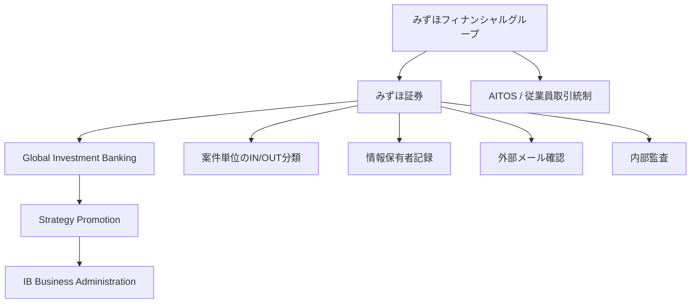
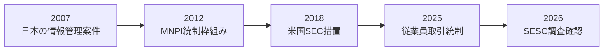
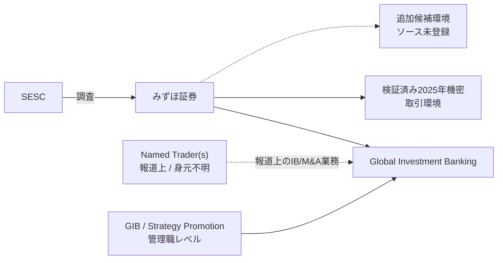
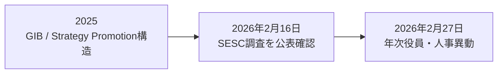

# PROJECT BLACKBIRD

# みずほ陰謀ファイル — 公開版

**情報管理リスク、取引ガバナンス、および2026年証券取引等監視委員会（SESC）調査に関する、プライバシー配慮型オープンソース・インテリジェンス事例研究**

| 項目 | 内容 |
|---|---|
| ケース参照 | JP-01 |
| 作成者 | Ninomae Tsukumo |
| 目的 | 個人研究・教育目的 |
| 分類 | Open Source / Unclassified |
| 調査基準日 | 2026年9月5日 |
| 版 | 公開版 / プライバシー最小化版 |
| 言語 | 日本語 |

**DOI:** 10.5281/zenodo.22987567  
**恒久アーカイブ:** https://doi.org/10.5281/zenodo.22987567

## 重要なお知らせ

本レポートは、個人的関心、教育目的、およびOSINT・分析技能の向上を目的として作成した独立したオープンソース・インテリジェンス事例研究です。規制当局、法執行機関、金融機関、雇用主、顧客、報道機関、政治団体、その他第三者の依頼に基づいて作成されたものではありません。

本レポートは、公に利用可能な情報のみを用いています。刑事、民事、規制上、または懲戒上の責任を判断するものではありません。

タイトル中の **「陰謀（Conspiracy）」** という語は、調査型ケーススタディの枠組みを示す名称です。本レポートが、陰謀、インサイダー取引スキーム、犯罪上の合意、情報漏えい、隠蔽、規制違反、または不正行為を立証したことを意味しません。

### プライバシー最小化方針

本公開版では、検証済みの制度・組織上の結論を理解するために個人名が不要な場合、個人名を削除または役職レベルに抽象化しています。可能な限り、組織上の役割、部門、企業、日付、統制、ソースIDを使用します。文書化された関係、同一雇用主、取引上の関係、ネットワーク上の近接性、図表への登場は、不正行為への関与を意味しません。

**定義されたケース用語 — Named Trader(s)：** 公開報道で取引行為が論じられている、身元不明の1名または複数名を指すProject Blackbirdの中立的な呼称です。この用語は、その人物の身元や人数が公開情報上判明していることを意味しません。

# 結論要旨（BLUF）

2026年2月16日、みずほ証券は、証券取引等監視委員会（SESC）が同社を調査していることを確認しました。同社は調査が継続中であり、全面的に協力すると述べました。ただし、同社の発表は、人物、銘柄、口座、取引、利益額、または疑われる手法を特定していません。**[SRC-0001]**

別の報道では、投資銀行業務に従事する身元不明のみずほ証券社員、業務上得た非公開情報、および複数銘柄の取引疑惑が報じられました。しかし、これらの内容は、みずほ証券の公式発表では確認されていないため、本レポートでは **Reported Information（報道情報）** として扱います。**[SRC-0002; SRC-0003]**

そのためProject Blackbirdは、個人の特定を公開分析の中心に置きません。本レポートは、制度・組織環境に焦点を当てます。具体的には、過去の情報管理問題、現代のMNPI（重要な未公表情報）管理および従業員取引統制、投資銀行部門の構造、2025年の選定された機密取引環境、組織上の時系列、競合する説明、ネガティブ・ファインディング、そして公開情報OSINTの限界です。

最も強く検証できた制度上の所見は、みずほの証券事業には情報管理上の問題が過去に確認されている一方で、形式的な統制も段階的に詳細化されてきたという点です。日本の規制当局は2007年、みずほ証券の情報管理案件を確認しました。米国SECは別件として、2018年にみずほ証券USAの機密発行体情報の取扱いに関する問題を認定しました。**[SRC-0017; SRC-0018; SRC-0019]**

2012年までに、みずほは重要な未公表情報の管理枠組みを公表していました。また、2025年にSEC提出資料として開示された手続では、従業員取引制限、情報伝達や取引推奨の制限、一部の第三者名義取引の扱い、およびAITOS統制システムが説明されています。**[SRC-0012; SRC-0020]**

**中心的インテリジェンス問い：** もし2026年に報じられた行為が最終的に事実と認定される場合、広範なMNPIおよび従業員取引統制を公に文書化していた組織内で、どのようにそれが起こり得たのか。現時点の公開情報OSINTでは、この問いに答えることはできません。

# 1. はじめに

## 1.1 目的

JP-01の目的は、2026年に報じられたみずほ証券に対するSESC調査について、公開情報から何を立証できるかを確認することです。あらかじめ決めた仮説を証明することが目的ではありません。

## 1.2 主要インテリジェンス要件

> 公開情報から、みずほ証券に対する2026年のSESC調査について何を立証できるか。

## 1.3 範囲

歴史的レビュー：2007年から2026年9月。詳細調査の重点：2024年から2026年。主な法域：日本。海外のみずほ関連資料は、歴史的比較または統制環境の理解に有用な場合に限って含めます。

## 1.4 対象外

- 私的通信やアクセス制限されたシステム。
- 私的な証券口座データや非公開の実質的所有者情報。
- 家族や無関係な私人。
- Named Trader(s)の身元推測。
- 通常の職業上の関係を不正行為の証拠として扱うこと。
- 刑事・規制上の責任を判断すること。
- 公開上の分析点を役職レベルで十分説明できる場合に、個人名を掲載すること。

# 2. 方法論

## 2.1 収集方針

収集では、規制当局、企業の公式発表、取引所開示、規制提出資料、一次的な企業文書を優先しました。公式情報にない事実については二次報道を使用しました。検索エンジン、フォーラム、公開プロフェッショナルプロフィール、アーカイブページは主として発見と裏付けに使用しました。

## 2.2 証拠モデル

| 分類 | 意味 |
|---|---|
| Verified Fact | 強い一次資料によって直接裏付けられた事実。 |
| Reported Information | 情報源で報じられているが、一次資料で独立して確認できていない情報。 |
| Analytical Judgment | 確立した事実に基づく分析上の判断。 |
| Hypothesis | 未立証の可能性のある説明。 |
| Alternative Explanation | 合理的な競合説明。 |
| Negative Finding | 定義された公開情報調査では、提案された関係を確認できなかったこと。 |
| Unknown | 利用可能な証拠だけでは判断できないこと。 |

**基本原則：** Source ≠ Claim ≠ Fact ≠ Conclusion（情報源 ≠ 主張 ≠ 事実 ≠ 結論）。

## 2.3 裏付けと競合説明

独立した裏付けと、同一情報の反復報道は区別しました。複数の記事が同じ元情報を繰り返している場合、それを複数の独立確認とは扱いません。

時系列のみを因果関係の証明として扱いません。ある観察事実に複数の説明があり得る場合、通常の人事ローテーション、計画された承継、通常のアドバイザリー報酬、市場の噂、通常のガバナンス慣行などの代替説明を残します。

## 2.4 AI支援OSINT

AIは、検索クエリ作成、情報源発見、日英比較、文書比較、エンティティ抽出、時系列整理、候補優先順位付け、仮説検証、ネガティブ・ファインディング管理、ネットワークデータ準備の高速化に使用しました。AIの出力そのものは証拠として扱っていません。重要な事実主張は、基礎となる情報源へ追跡可能であることを要件としました。

## 2.5 プライバシーと比例性

公開版ではデータ最小化を適用しています。無関係な私的情報、家族情報、個人住所、弱い社会的近接性、不要な個人名、個人レベルのネットワーク詳細は、検証済みの公開上の結論に不可欠でない限り除外します。

# 3. 調査結果

## 3.1 2026年調査の確認

みずほ証券は、2026年2月16日時点でSESCが同社を調査していることを確認しました。同社は調査が継続中であり、全面的に協力すると述べました。**[SRC-0001]**

公式発表は、疑われる取引手法、銘柄、口座、利益、Named Trader(s)の身元を明らかにしていません。

## 3.2 追加の公開報道

朝日新聞は、調査対象となっている社員がみずほ証券の投資銀行部門に所属し、M&A関連業務を通じて非公開の企業情報を得て、複数銘柄の取引に関与した疑いがあると報じました。また、2026年1月に強制調査が行われたとも報じています。**[SRC-0002]**

The Japan Timesは投資銀行部門に関する内容を報じていますが、その点について先行報道を引用しているため、独立した裏付けとは扱いません。**[SRC-0003]**

これらは **Reported Information（報道情報）** のままです。

## 3.3 過去の情報管理案件

SESCおよびFSA資料は、2007年に、みずほ証券が非公開の顧客情報を受領・利用した案件を確認しています。FSAは業務改善命令を発出しました。**[SRC-0017; SRC-0018; SRC-0004]**

米国SECは別件として、みずほ証券USAが2012年から2014年にかけて発行体の機密自己株式取得情報を不適切に取り扱ったと認定し、2018年に執行措置が行われました。**[SRC-0019]**

これらはそれぞれ独立した歴史的案件です。2007年から2026年まで続く一つのスキームや、各時期の人物の連続的な関与を立証するものではありません。

## 3.4 MNPIおよび従業員取引の形式的統制

2012年8月7日、みずほ証券は重要な未公表情報の不公正利用を防止するための枠組みを公表しました。そこでは、案件ごとのIN/OUT分類、情報保有者の管理、モニタリング、外部メール確認、内部監査、need-to-knowの考え方が説明されています。**[SRC-0012]**

2025年にSECへ提出されたみずほの手続資料では、インサイダー情報を知りながらの自己取引禁止、一定の情報伝達・取引推奨の禁止、一部の第三者名義取引の自己取引扱い、AITOSが説明されています。**[SRC-0020]**

## 3.5 検証済みの2025年機密取引環境

JPXに登録された開示資料は、2025年の博報堂DYホールディングスによるデジタルホールディングスへの公開買付けにおいて、みずほ証券がデジタルホールディングスのフィナンシャル・アドバイザーを務めたことを確認しています。みずほの関与は公表前から確認され、開示資料には、みずほ証券とみずほ銀行に関する情報遮断・利益相反管理の説明も含まれています。**[SRC-0008]**

これは、みずほ証券が関与した機密取引環境が少なくとも1件存在したことを検証します。ただし、デジタルホールディングス株が2026年調査の対象銘柄だったことを示すものではありません。

その他の候補取引については、基礎となる一次文書が証拠パッケージに完全登録されていないものがあり、分析上のリードとしてのみ保持します。本公開版では検証済み事実へ昇格させません。

## 3.6 組織上の時系列

みずほは2026年2月16日にSESC調査を公表確認しました。その後、2月27日にGlobal Investment Banking / Strategy Promotionの構造に関係する役員・人事異動を含む公表を行いました。**[SRC-0001; SRC-0014; SRC-0015]**

この順序自体は確認済みです。ただし因果関係は立証されていません。

## 3.7 ネガティブ・ファインディング

公開情報調査では、以下を確認できませんでした。

- 2026年案件で具体的に取引された銘柄。
- Named Trader(s)の身元または人数。
- 口座、取引相手、受益者。
- 正確な情報伝達経路。
- 調査対象となった個人またはガバナンス上の人物が疑われる取引に直接関与したこと。
- 関連する機密取引環境の存在を超えて、特定の候補取引が2026年調査に関与したこと。
- 2月16日の公表確認と2月27日の人事異動の因果関係。
- 調査基準日時点での2026年SESC/FSA/検察による最終的な執行・処分結果。

# 4. 分析

## 4.1 統制アーキテクチャ

**図1. 登録済み情報源から再構築したプライバシー最小化版の統制アーキテクチャ。統制構造を理解するために個人名は不要です。**

## 4.2 想定可能な統制経路 — 分析モデルのみ

| モデル | 想定されるメカニズム |
|---|---|
| A | 正規に情報アクセスを持つ者が、制限に反して取引する。 |
| B | 正規の情報保有者が、他者へ情報提供または取引推奨を行う。 |
| C | 情報が内部バリアを越え、権限のない人物へ伝わる。 |
| D | 第三者名義または実質的所有者口座を通じて取引する。 |
| E | 承認、監視、検知の統制が当該行為を特定できない。 |

公開情報では、これらのいずれかが実際に起きたことを立証できません。

## 4.3 情報管理の歴史的タイムライン

**図2. 歴史的タイムライン。この連続性は、繰り返し情報管理リスクへ注意が向けられてきたことを示すものであり、一つの継続的スキームを示すものではありません。**

## 4.4 役職レベルの関係モデル

**図3. 役職レベルの関係モデル。個人名は分析上の結論に不要なため省略しています。破線は報道情報またはソース未登録の関係を示し、不正行為との検証済みリンクではありません。**

## 4.5 組織上の時系列

**図4. 時系列のみ。因果関係は立証されていません。個人名は意図的に省略しています。**

## 4.6 競合説明

| 観察事項 | 可能な解釈 | 競合説明 | 評価 |
|---|---|---|---|
| 公表確認後の人事異動 | 調査への経営対応 | 通常の年次ローテーション、計画された承継、キャリア移行、無関係な組織再編 | 調査連動説の信頼度は低い |
| 金融業界出身者がガバナンス役職に存在 | 反復する意味あるネットワーク | 通常の金融業界人材移動、独立した取締役選定 | 構造上の観察にとどまる |
| M&A成功報酬 | 取引完了へのインセンティブ | 通常のM&Aアドバイザリー報酬 | それ自体は不審ではない |
| 公表前の市場値動き | 情報漏えいの可能性 | 公開済みの噂、市場投機、通常取引 | 個別イベントごとの証拠が必要 |

## 4.7 公開情報で立証できないこと

公開OSINTでは、制度・組織環境から個人行為へ至る最後の証拠の橋を渡ることができません。そのためには通常、内部アクセスログ、通信記録、証券口座記録、案件チーム記録、実質的所有者の証拠、証言、または規制当局の認定が必要です。これらは現在の公開情報パッケージには存在しません。

# 5. タイムライン

| 日付 | 出来事 | 分類 | ソース |
|---|---|---|---|
| 2006-2007 | みずほ証券による非公開顧客情報の受領・利用に関してSESC/FSA対応。 | Verified Historical | SRC-0017; SRC-0018 |
| 2012-07-03 | FSAによる業界横断的なMNPI管理レビュー・大臣発言。 | Verified Historical | SRC-0016 |
| 2012-08-07 | みずほ証券がMNPI管理枠組みを公表。 | Verified Historical | SRC-0012 |
| 2012-2014 | みずほ証券USAの発行体機密情報取扱い。後にSEC案件となる。 | Verified Historical | SRC-0019 |
| 2018 | みずほ証券USAに対するSEC措置。 | Verified Historical | SRC-0019 |
| 2025年4月初旬 | 後のJPX開示により、公表前の機密取引環境へのみずほ証券の関与が確認。 | Verified | SRC-0008 |
| 2026年1月下旬 | 身元不明の社員に関係する強制調査が行われたと報道。 | Reported | SRC-0002 |
| 2026-02-16 | みずほ証券がSESC調査を公表確認。 | Verified | SRC-0001 |
| 2026-02-27 | 関連する組織構造に影響する役員・人事異動を公表。因果関係は未立証。 | Verified | SRC-0014 |

# 6. 関連組織・役職

本公開版では、不要な個人名を掲載せず、組織名および役職レベルのラベルを使用します。

| 組織 / 役職 | 状態 | 関連性 | 注意 |
|---|---|---|---|
| みずほ証券株式会社 | Verified | SESC調査を受けていることを公式確認した企業 | 調査の存在自体は、個人の不正行為を立証しない |
| 証券取引等監視委員会（SESC） | Verified | 調査を行う規制当局 | 公開されている調査詳細は限定的 |
| Named Trader(s) | Reported / Unidentified | 報道で言及される人物を指す中立的ケース用語 | 身元・人数は公開情報上未確定 |
| Global Investment Banking | Verified organisational structure | 報道が投資銀行業務を示したため関連 | 部門との関係は構成員の不正を意味しない |
| Strategy Promotion / 関連管理職 | Verified organisational structure | 統制経路と時系列分析に関連 | 役職者を疑われる取引と結ぶ公開証拠はない |
| 2025年デジタルホールディングス取引環境 | Verified | みずほ証券が関与した機密アドバイザリー環境を1件確認 | 同銘柄が2026年案件に含まれた証拠はない |
| 追加の候補取引環境 | Source-pending / analytical | 比較分析上のリードのみ | 検証済み案件事実には昇格させない |

# 7. 評価

| ID | 信頼度 | 判断 | 根拠 |
|---|---|---|---|
| KJ-1 | High | みずほ証券には2007年に確認された日本国内の情報管理問題があり、SESC/FSA対応が行われた。 | SRC-0017; SRC-0018 |
| KJ-2 | High | みずほ証券USAは別件として、発行体機密情報の管理について2018年にSEC措置を受けた。 | SRC-0019 |
| KJ-3 | High | みずほは2026年調査の公表前から、MNPIおよび従業員取引に関する詳細な統制を公に文書化していた。 | SRC-0012; SRC-0020 |
| KJ-4 | High | 2026年SESC調査の存在は、みずほ証券自身が確認している。 | SRC-0001 |
| KJ-5 | Moderate | 報道は投資銀行業務および複数銘柄との関係を示すが、その詳細はみずほの公式発表では確認されていない。 | SRC-0002; SRC-0003 |
| KJ-6 | Moderate | 2025年にみずほ証券が関与した機密取引環境が少なくとも1件確認できるが、より広い候補群の一部はソース未登録である。 | SRC-0008 |
| KJ-7 | High | 公開情報は、銘柄、Named Trader(s)、口座、受益者、正確な利益、情報伝達経路を立証していない。 | Negative findings |
| KJ-8 | High | 登録済み公開資料は、分析対象となった組織・ガバナンス上の人物が疑われる取引に参加したことを立証していない。 | Negative findings / entity cautions |

## 総合評価

公開記録から、過去の情報管理問題、形式的なMNPI統制枠組み、少なくとも1件の2025年みずほ証券関与の機密取引環境、組織上の関係、2026年調査前後の人事異動は確認できます。一方、どの銘柄が取引されたか、誰が取引したか、情報がどのように移動したか、確認された制度・組織上の関係が調査対象の行為に寄与したかは、公開情報では立証できません。

# 8. 調査状況と再開条件

広範な探索調査は一旦停止しています。今後は、制度・組織環境と調査対象行為の間のギャップを実質的に狭める新しい公開情報が出た場合にのみ再開します。

1. SESCまたはFSAによる新たな公表、勧告、告発、行政処分。
2. 関連銘柄の公的特定。
3. 調査に直接関連する案件チームまたは具体的な担当役割の信頼できる特定。
4. 公開された通信記録、裁判資料、規制当局提出証拠。
5. 重要な懲戒または内部調査の開示。
6. 既存候補、情報アクセス経路、2026年案件を直接結ぶ証拠。

# 付録A — 公開ソース登録簿

本公開ソース登録簿には、公開版の結論を支えるために必要な情報源のみを掲載します。公開上の結論に不要な個人特定型の情報源は意図的に省略しています。

| SRC | 発行元 | タイトル / 概要 | 公表日 | 種別 | 信頼性 |
|---|---|---|---|---|---|
| SRC-0001 | みずほ証券株式会社 | 本日の一部報道について | 2026-02-16 | Primary / Corporate | High |
| SRC-0002 | 朝日新聞 | インサイダー取引疑惑調査に関する報道 | 2026-02-16 | Secondary / Media | Medium-High |
| SRC-0003 | The Japan Times | Mizuho Securities reportedly faces probe for insider trading | 2026-02-16 | Secondary / Media | Medium-High |
| SRC-0004 | 金融庁 | 行政処分事例集 | 2026-06-30 | Primary / Government dataset | High |
| SRC-0005 | Mizuho Financial Group / U.S. SEC | Procedures for Controlling Insider Trading — 2026 revision | 2026-04-01 | Primary / Regulatory filing | High |
| SRC-0006 | みずほ証券株式会社 | 不公正取引について | — | Primary / Corporate | High |
| SRC-0007 | みずほ証券株式会社 | 内部者（内部者登録）とは何ですか？ | 2017-05-08 | Primary / Corporate FAQ | High |
| SRC-0008 | デジタルホールディングス / JPX | みずほ証券をアドバイザーとして特定する公開買付け意見表明資料 | 2025-09-11 | Primary / Exchange disclosure | High |
| SRC-0012 | みずほ証券 / みずほグループ | Establishment of a system to prevent unfair use of material non-public information | 2012-08-07 | Primary / Corporate | High |
| SRC-0014 | みずほフィナンシャルグループ | 役員人事について | 2026-02-27 | Primary / Corporate | High |
| SRC-0015 | みずほ証券株式会社 | 2025年ディスクロージャー / 組織構造 | 2025-03 | Primary / Corporate | High |
| SRC-0016 | 金融庁 | 金融担当大臣記者会見 | 2012-07-03 | Primary / Government | High |
| SRC-0017 | 証券取引等監視委員会 | 2007年行政処分勧告 | 2007-10-19 | Primary / Regulator | High |
| SRC-0018 | 金融庁 | 2007年みずほ証券に対する行政処分 | 2007-10-26 | Primary / Government | High |
| SRC-0019 | U.S. Securities and Exchange Commission | Administrative and Cease-and-Desist Proceedings: Mizuho Securities USA LLC | 2018-07-18 | Primary / Regulator | High |
| SRC-0020 | Mizuho Financial Group / U.S. SEC | Procedures for Controlling Insider Trading — 2025 exhibit | 2025 | Primary / Regulatory filing | High |

**方法論参考：** METH-001 — Nico Dekens (Dutch OSINT Guy), “OSINT Analysis Intelligence Report Writing”, 17 Nov 2025, updated Jan 2026.

# 付録B — 公開クレーム・マトリクス

| Claim ID | 公開版の主張 | 分類 | 信頼度 | 証拠 |
|---|---|---|---|---|
| CLM-P01 | みずほ証券は2026年2月16日時点でSESC調査を受けていることを確認した。 | Verified Fact | High | SRC-0001 |
| CLM-P02 | みずほは調査が継続中であり、協力すると述べた。 | Verified Fact | High | SRC-0001 |
| CLM-P03 | 報道は、投資銀行業務と複数銘柄との関連を示した。 | Reported Information | Moderate | SRC-0002; SRC-0003 |
| CLM-P04 | 2007年のみずほ証券の情報管理案件は規制対応につながった。 | Verified Historical Fact | High | SRC-0017; SRC-0018 |
| CLM-P05 | みずほ証券は2012年にMNPI管理枠組みを公表した。 | Verified Historical Fact | High | SRC-0012 |
| CLM-P06 | みずほ証券USAは2018年、発行体機密情報に関するSEC措置を受けた。 | Verified Historical Fact | High | SRC-0019 |
| CLM-P07 | みずほグループは、2026年調査公表前から従業員取引・情報伝達防止統制を文書化していた。 | Verified Control Fact | High | SRC-0020 |
| CLM-P08 | みずほ証券は少なくとも1件の検証済み2025年機密取引環境でフィナンシャル・アドバイザーを務めた。 | Verified Fact | High | SRC-0008 |
| CLM-P09 | 公開情報は、2026年案件の銘柄、人物、口座、受益者、正確な利益、情報伝達経路を立証していない。 | Negative Finding | High | Public record / negative findings |
| CLM-P10 | 調査公表後に組織上の変更が発表されたが、公開情報は因果関係を立証していない。 | Verified chronology / Negative Finding | High | SRC-0001; SRC-0014 |

# 付録C — プライバシーおよび公開版変更点

内部調査マスターと比較して、本公開版では以下を行っています。

- 個人レベルのネットワーク図を削除。
- 図中の個人名を役職レベルのラベルへ置換。
- 制度上の結論に不要な個人キャリア時系列を削除。
- 個人特定型の主張および未登録ソース項目を公開クレーム・マトリクスから削除。
- 役職レベルの表現で十分な場合、ネガティブ・ファインディングから個人名を削除。
- 公開版の結論に不要な個人レベルの情報源を省略。
- 組織、規制当局、部門、取引環境、日付、統制、ソースID、証拠分類、分析上の限界は保持。

これらの変更により、分析上の主要結論を変えずに、不必要なプライバシー・評判リスクを抑えています。

# 最終調査声明

JP-01は陰謀を立証していません。調査過程で検討した人物の不正行為を立証していません。2026年調査で取引された銘柄も特定していません。

本ケースの価値は、通常の単発報道では一つに整理されない公開記録上の制度環境を再構築したことにあります。すなわち、過去の情報管理記録、現代のMNPI・従業員取引統制、投資銀行部門の構造、検証済みの機密取引環境、競合説明、ネガティブ・ファインディング、そして公開情報の限界です。

新たな公開情報が、制度・組織環境と調査対象行為との間のギャップを実質的に狭める場合にのみ、本レポートを再開すべきです。
